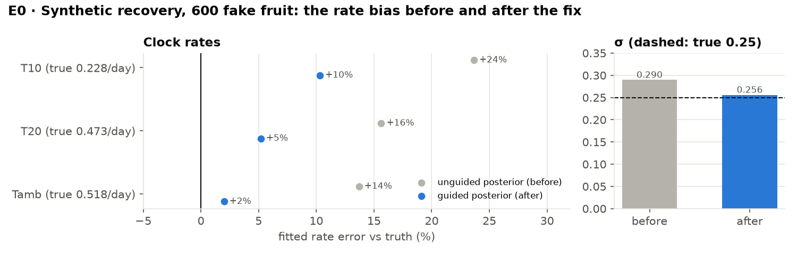
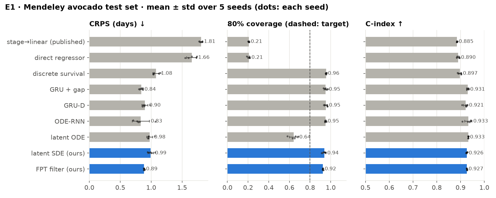
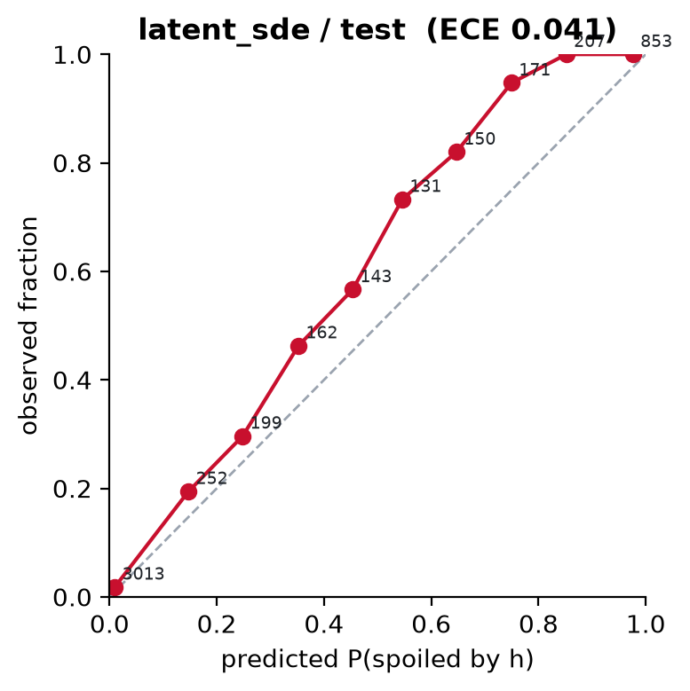
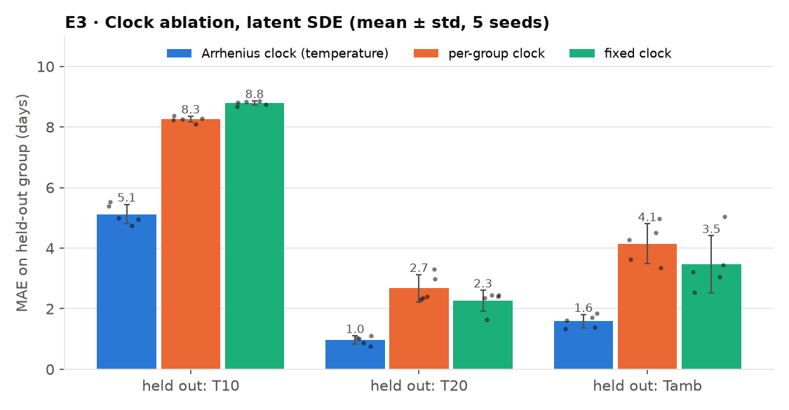
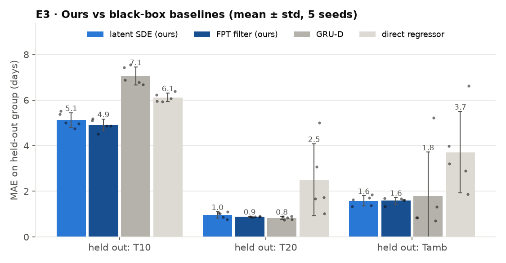
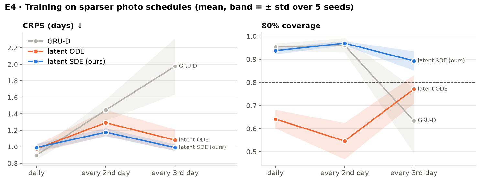
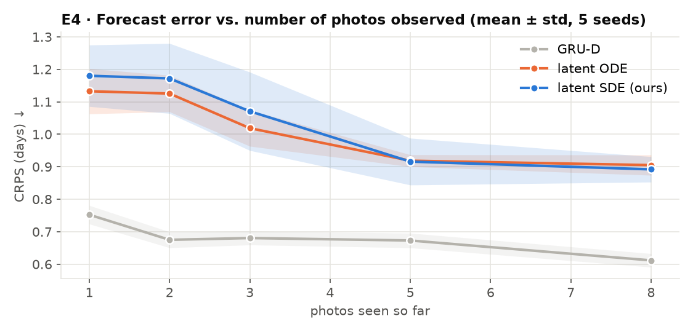
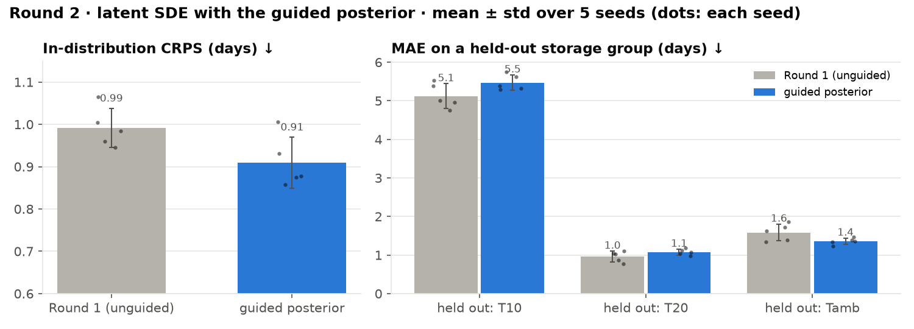

# Results report: neural SDE first-passage models

**Progress report · updated 5 November 2026 (Round 2 complete: guided posterior on every experiment, five new
baselines, paired significance tests)** · avocado numbers (E1–E4) are mean ± sample std over **5 independent
seeds** from `outputs/avocado/round1/seed*/<run>/metrics_test.json` (Round 1), `outputs/avocado/round2/` (guided
latent SDE) and `outputs/avocado/baselines/` (new baselines); synthetic numbers are one run from
`outputs/runs/*/metrics_test.json`. **For the current headline numbers, read [Round 2b](#round-2b--every-experiment-with-the-guided-posterior)
and [New baselines](#new-baselines-classical-degradation-models-neural-cde-transformer) first**; E1–E6 below are the Round 1
(unguided) record. Regenerated by
`python scripts/analysis/summarize.py && python scripts/analysis/summarize_seeds.py && python scripts/analysis/make_report_figures.py`.

> **What the 5-seed rerun changed.** Each avocado run was retrained 5 times with a different seed for the
> initialisation and the batch order. The train/test split stayed fixed, so the spread is training variance only.
> Three seed-0 claims hold up: the Arrhenius clock beats both ablated clocks (every seed, every held-out
> temperature), the latent ODE's intervals are too narrow, and the latent SDE is the most robust model under
> sparse photos. Two claims are weaker than seed 0 suggested. ODE-RNN's in-distribution win (CRPS 0.69) was a
> good draw; over 5 seeds it ties GRU + gap. And the latent SDE does **not** beat GRU-D on every held-out
> temperature: seed 0 drew a bad GRU-D, and on T20 and ambient GRU-D is as good or better when it doesn't fail.

---

## 1. Setup

Predict a calibrated distribution over the time until an item crosses a failure boundary, from irregular,
interval- or right-censored observations. The model is a latent neural SDE
$dR = \kappa(T)\mu_\theta(R)\,dt + \sqrt{\kappa(T)}\,\sigma_\theta(R)\,dW_t$. The time change $\kappa$ is
an Arrhenius law with a learned activation energy. The event is the first passage of $R$ across a learned
boundary $b$, and its distribution comes from the backward Kolmogorov PDE (method details in the
[README](../../../README.md) and [`docs/background/theory.md`](../../background/theory.md)). The **latent ODE** is the same model with
$\sigma \equiv 0$.

There are seven baselines, all with the same trainer and evaluation. **Metrics** are computed on the test
split at every prefix of every item: MAE, CRPS, 80% interval coverage (target 0.80) and C-index.

## 2. Data

| Dataset | What | Size | Time unit |
|---|---|---|---|
| Mendeley avocado (CC BY 4.0) | daily photos, 3 storage temperatures (T10, T20, ambient) | 478 fruit, 14,710 photos | days |
| A2SL microwave (Univ. of Alabama) | microwave scans + photos, every other day — **added this week** | 15 fruit (4 tracked) | days |
| Synthetic fruit | generated from a known SDE, to check parameter recovery | 600 items | days |

All runs used the UMIACS Nexus class cluster (RTX A4000/A5000, one GPU per job, submitted with `sbatch`).

---

## 3. Results

### E0 · Sanity check: can the model recover a known process?

On synthetic data generated with known per-temperature rates and noise (600 fake fruit), the original latent SDE
recovered the **ordering** of the rates and the rate *ratios*, but every rate came out too fast (true
0.228 / 0.473 / 0.518 → fitted 0.282 / 0.547 / 0.589, i.e. +24 / +16 / +14 %). The two slow recovery tests in CI
failed for the same reason.

**Diagnosis (3 November).** The exact likelihood of these labels, computed by the grid filter with the rates frozen
at *f* × truth, peaks at *f* = 1.0, so the data identify the true rates. The bias came from the latent SDE's
training objective: its ELBO sits ~4 nats per fruit below the exact likelihood, and that gap shrinks as the clock
speeds up, because the cost of steering a posterior path falls like 1/κ. The ELBO's optimum therefore sits at a
fast clock. The old explanation, that the starting ripeness is not identified, was wrong: pinning it to the truth
left the bias, and a bigger posterior network made it worse.

**Fix.** The posterior drift now includes the closed-form pull toward the next observed stage (a *guided
proposal*: the exact posterior drift for one observation), and the forecast term averages probabilities over
posterior samples before taking the log. The ELBO gap halves and the rates come out nearly unbiased:



| 600 fake fruit | T10 rate | T20 rate | Tamb rate | σ | fresh-fruit CDF error |
|---|---|---|---|---|---|
| truth | 0.228 | 0.473 | 0.518 | 0.250 | — |
| before (unguided posterior) | 0.282 (+24 %) | 0.547 (+16 %) | 0.589 (+14 %) | 0.290 | 0.31 |
| **after (guided posterior)** | **0.252 (+10 %)** | **0.498 (+5 %)** | **0.528 (+2 %)** | **0.256** | **0.18** |

In the smaller CI test (180 fruit, 14 epochs, 5 seeds) the rates land within −2…+13 % and the Arrhenius activation
energy within −10…+6 %; all three slow recovery tests now pass. The guided posterior is **off by default**: every
number in E1–E6 is from the unguided model; Round 2 adds the guided one. Full diagnosis in
[`docs/archive/verifier_report.md`](../../archive/verifier_report.md) ("Rate-recovery bias, revisited").

### E1 · Avocado: all models, standard split



| Model | CRPS ↓ | MAE ↓ | 80 % cov. | C-index ↑ |
|---|---|---|---|---|
| stage → linear (published baseline) | 1.81 ± 0.02 | 1.81 ± 0.02 | 0.21 ± 0.00 | 0.885 ± 0.001 |
| direct regressor | 1.66 ± 0.08 | 1.66 ± 0.08 | 0.21 ± 0.01 | 0.890 ± 0.005 |
| discrete survival | 1.08 ± 0.06 | 1.52 ± 0.08 | 0.96 ± 0.00 | 0.897 ± 0.007 |
| GRU + gap | 0.84 ± 0.03 | **1.15 ± 0.03** | 0.95 ± 0.02 | 0.931 ± 0.004 |
| GRU-D | 0.90 ± 0.05 | 1.25 ± 0.08 | 0.95 ± 0.02 | 0.921 ± 0.008 |
| ODE-RNN | **0.83 ± 0.14** | 1.16 ± 0.20 | 0.95 ± 0.01 | **0.933 ± 0.015** |
| latent ODE | 0.98 ± 0.05 | 1.26 ± 0.07 | **0.64 ± 0.04** | 0.933 ± 0.001 |
| latent SDE (ours) | 0.99 ± 0.05 | 1.41 ± 0.08 | 0.94 ± 0.02 | 0.926 ± 0.002 |
| FPT filter (ours) | 0.89 ± 0.01 | 1.25 ± 0.02 | 0.93 ± 0.00 | 0.927 ± 0.001 |

*(mean ± std over 5 seeds; test split, every prefix of every test fruit.)*

**Takeaways.**
* Every distributional model beats the published classify-then-regress baseline (CRPS 1.81 → 0.83–1.08).
  Point predictors are badly over-confident (80 % coverage of 0.21).
* **SDE vs ODE:** they rank fruit equally well (C ≈ 0.93), but the deterministic latent ODE's 80 % intervals
  contain the truth only **64 ± 4 %** of the time, versus 94 ± 2 % for the SDE (ECE 0.047 vs 0.031). The gap is
  far outside the seed spread. The noise term is what fixes the over-confidence. The SDE errs the
  other way: its intervals are wider than they need to be for 80 %.
* **No in-distribution winner.** ODE-RNN (0.83 ± 0.14) and GRU + gap (0.84 ± 0.03) tie on CRPS. Seed 0's ODE-RNN
  (0.69) was a good draw, and one of the five new seeds scored 1.07. The FPT filter is the most *stable* model
  (CRPS std 0.008) and is close behind (0.89). The latent SDE's advantage is not in-distribution accuracy; it
  shows up under transfer (E3) and sparse sampling (E4).



### E2 · Exact PDE likelihood vs Monte Carlo

| Latent SDE likelihood | Avocado CRPS | Avocado 80 % cov. | Avocado 80 % width | Synthetic CRPS | Synthetic 80 % cov. |
|---|---|---|---|---|---|
| exact (backward Kolmogorov PDE) | 1.02 ± 0.06 | 0.92 ± 0.02 | 5.0 d | 3.23 | 0.71 |
| Monte Carlo (smoothed crossing) | **0.92 ± 0.05** | **0.80 ± 0.03** | 2.8 d | **1.41** | 0.87 |

*(Avocado: the exact row pools the two identically-configured runs `latent_sde_avocado` and `latent_sde_avocado_pde`,
10 seeds; MC is 5 seeds. Synthetic: one run.)*

With 5 seeds, **Monte Carlo wins on avocado too**. Its CRPS is lower in every seed, and its coverage lands on the
0.80 target while the exact likelihood's intervals are almost twice as wide. Seed 0 suggested that the exact
likelihood was better calibrated on avocado, but that reading took over-coverage as a good sign. Since the exact
method should be at least as good, this is a real open problem (see §5), not a noise effect.

### E3 · Transfer to a storage temperature never seen in training

Train on two temperature groups, test on the third. The only thing that changes between the three bars is the
clock $\kappa$.



| Held-out group | Arrhenius clock | per-group clock | fixed clock | better ablated / Arrhenius |
|---|---|---|---|---|
| T10 (cold) | **5.1 ± 0.3** | 8.3 ± 0.1 | 8.8 ± 0.1 | 1.6× (1.5–1.7 across seeds) |
| T20 | **1.0 ± 0.1** | 2.7 ± 0.5 | 2.3 ± 0.3 | 2.4× (1.6–3.1) |
| ambient | **1.6 ± 0.2** | 4.1 ± 0.7 | 3.5 ± 0.9 | 2.2× (1.6–2.5) |

*(MAE in days on the held-out group, latent SDE, mean ± std over 5 seeds.)* **This is the main result, and it is
robust.** The physically-structured clock beats the better of the two ablated clocks in **all 15 seed × group
pairs**, cutting transfer error **1.6–2.4×** on average.

**Against black-box models** the picture is more mixed than the single run suggested:



| Held-out group | latent SDE | FPT filter | GRU-D | direct regressor |
|---|---|---|---|---|
| T10 (cold) | 5.1 ± 0.3 · cov 0.19 | **4.9 ± 0.3** · cov 0.20 | 7.1 ± 0.4 · cov 0.13 | 6.1 ± 0.2 · cov 0.06 |
| T20 | 1.0 ± 0.1 · cov 0.95 | 0.9 ± 0.0 · cov 0.89 | **0.8 ± 0.1** · cov 0.97 | 2.5 ± 1.6 · cov 0.17 |
| ambient | 1.6 ± 0.2 · cov 0.69 | 1.6 ± 0.1 · cov 0.74 | 1.8 ± 1.9 · cov 0.76 | 3.7 ± 1.8 · cov 0.09 |

*(MAE in days · 80 % coverage.)*
* **Cold storage (T10), which requires extrapolating below the training range:** both of our models are clearly
  better than both baselines (4.9–5.1 vs 6.1–7.1 days). Even so, coverage is ≈ 0.2, so every model's intervals
  are far too narrow there.
* **T20 (interpolation between the other two):** GRU-D is slightly *better* than the latent SDE (0.8 vs 1.0).
  The seed-0 GRU-D result (3.0) was an outlier; all five new seeds landed at 0.76–0.91.
* **Ambient:** the means are close, but GRU-D is unstable. Four seeds scored 0.7–1.3 days, better than the latent
  SDE, and one scored 5.2. The latent SDE and FPT filter stay within 1.3–1.9 in every seed.

The defensible claim is therefore: the Arrhenius clock is worth 1.6–2.4× within the SDE family; our models win
outright on extrapolation to a colder temperature; and they are **more reliable from seed to seed** than the
black-box baselines, which can match them on interpolation.

### E4 · Fewer photos

Models retrained with a photo every 2nd or 3rd day:



| Schedule | latent SDE CRPS | latent ODE CRPS | GRU-D CRPS | latent SDE cov. | latent ODE cov. | GRU-D cov. |
|---|---|---|---|---|---|---|
| daily | 0.99 ± 0.05 | 0.98 ± 0.05 | **0.90 ± 0.05** | 0.94 | 0.64 | 0.95 |
| every 2nd day | **1.18 ± 0.05** | 1.29 ± 0.16 | 1.45 ± 0.13 | 0.97 | 0.55 | 0.96 |
| every 3rd day | **0.99 ± 0.04** | 1.08 ± 0.13 | 1.98 ± 0.34 | 0.89 | 0.77 | 0.63 |

With sparser photos the latent SDE has the best CRPS at both rates and the smallest seed spread. On the
every-3rd-day schedule its error matches its daily-schedule error, while GRU-D's doubles (0.90 → 1.98) and its
coverage drops to 0.63. The latent ODE stays close on CRPS but keeps under-covering. Seed 0's every-3rd-day SDE
CRPS (0.81) was a good draw; the mean is 0.99.



Error falls as more photos are seen. On the daily schedule GRU-D is better early on, which is consistent with E1.

### E6 · A2SL microwave avocados (new data)

| Model | MAE (days) | CRPS | 80 % cov. | C-index |
|---|---|---|---|---|
| GRU-D | 5.56 | 3.79 | 0.89 | 0.500 |
| FPT filter | 1.44 | 1.04 | 0.89 | 0.844 |
| **latent SDE** | **1.00** | 1.20 | 0.89 | 0.781 |
| latent SDE + feature decoder | 3.00 | 1.97 | 0.78 | 0.422 |

Only 4 fruit are tracked to spoilage, so there are just **9 test instances**. Read this as a proof that the
pipeline runs on a second sensing modality, not as evidence for one model over another.

---

### Round 2 · Guided posterior and recalibration (4–5 November)

The E0 fix (guided posterior + predictive event term) on real data: the latent SDE retrained with
`model.posterior_guidance=true model.event_mean=log_mean`, ResNet-18 features, same split and seeds 1–5, in-distribution
and on the three held-out storage groups. Post-hoc PIT recalibration (fitted on the validation split, applied to test,
no retraining) is applied to both rounds. Results: [`outputs/avocado/round2/summary.md`](tables/round2_summary.md)
and `summary_recal.md`; Round 1 recalibrated: [`outputs/avocado/round1/summary_recal.md`](tables/round1_summary_recal.md).



| Latent SDE, in-distribution | CRPS ↓ | MAE ↓ | 80 % cov. | 80 % width | ECE ↓ |
|---|---|---|---|---|---|
| Round 1 (unguided) | 0.99 ± 0.05 | 1.41 ± 0.08 | 0.94 | 5.2 d | 0.031 |
| guided posterior | 0.91 ± 0.06 | 1.30 ± 0.13 | 0.94 | 4.4 d | 0.020 |
| guided posterior, recalibrated | **0.85 ± 0.01** | 1.20 ± 0.03 | 0.93 | 4.3 d | 0.018 |
| *GRU + gap, recalibrated (best baseline)* | *0.82 ± 0.04* | *1.15 ± 0.06* | *0.91* | *3.9 d* | *0.029* |
| *ODE-RNN, recalibrated* | *0.80 ± 0.09* | *1.14 ± 0.13* | *0.92* | *3.9 d* | *0.017* |

**Takeaways.**
* **The guided posterior helps in-distribution.**
  * CRPS falls 8 % and the intervals are 15 % narrower at the same coverage.
  * With recalibration the latent SDE scores 0.85 ± 0.01, within one std of the best baselines and with the smallest
    seed spread of the three.
* **Transfer is mixed, and cold storage got worse.**

  | Held-out group | Round 1 (unguided) | guided posterior |
  |---|---|---|
  | T10 (cold) | **5.1 ± 0.3** · cov 0.19 | 5.5 ± 0.2 · cov 0.07 |
  | T20 | **1.0 ± 0.1** · cov 0.95 | 1.1 ± 0.1 · cov 0.82 |
  | ambient | 1.6 ± 0.2 · cov 0.69 | **1.4 ± 0.1** · cov 0.74 |

  *(MAE in days · 80 % coverage, mean ± std over 5 seeds.)* Guidance sharpens the intervals, which helps
  in-distribution and on ambient. On a temperature colder than anything in training, the sharper intervals are more
  over-confident.
* **Recalibration.**
  * In-distribution it lowers CRPS 2–5 % for every distributional model. It brings coverage from 0.93–0.96 down to
    0.86–0.93, near the 0.85–0.88 that a perfect forecaster scores on this metric (see
    [the plan's note](../../plans/round2_plan.md)).
  * It does not help under transfer: the validation PIT comes from the training temperatures.
  * It should not be applied to the point predictors (stage → linear, direct regressor): their step-function CDFs get
    smeared and their CRPS gets worse.
* The clock ablation (E3), likelihood comparison (E2), sparse photos (E4) and A2SL (E6) were rerun with guidance in
  Round 2b, below.

### Round 2b · Every experiment with the guided posterior

Same model as Round 2 (guided posterior, predictive event term, ResNet-18 features), 5 seeds each, in
[`outputs/avocado/round2/`](tables/round2_summary.md). Unrecalibrated unless marked.

**E3 again: the Arrhenius clock still wins every held-out group.**

| Held-out group | Arrhenius clock | per-group clock | fixed clock | better ablated / Arrhenius |
|---|---|---|---|---|
| T10 (cold) | **5.5 ± 0.2** · cov 0.07 | 8.3 ± 0.1 · cov 0.01 | 8.9 ± 0.1 · cov 0.00 | 1.5× |
| T20 | **1.1 ± 0.1** · cov 0.82 | 3.0 ± 0.2 · cov 0.15 | 2.3 ± 0.3 · cov 0.91 | 2.1× |
| ambient | **1.4 ± 0.1** · cov 0.74 | 4.2 ± 0.3 · cov 0.00 | 3.3 ± 0.4 · cov 0.66 | 2.4× |

*(MAE in days · 80 % coverage.)* The guided runs reproduce the Round 1 result: the physical clock cuts transfer
error 1.5–2.4× against the better ablation, and 1.5–3.1× against the per-group clock.

**E4 again: sparse photos are where the latent SDE clearly wins.**

| Schedule | latent SDE (guided) | transformer | Wiener | GRU-D | gamma | neural CDE | landmark Cox |
|---|---|---|---|---|---|---|---|
| daily | 0.91 | **0.74** | 1.32 | 0.90 | 1.21 | 1.10 | 1.66 |
| every 2nd day | **1.12** | 1.38 | 1.58 | 1.45 | 1.48 | 2.07 | 1.99 |
| every 3rd day | **0.97** | 1.89 | 1.52 | 1.98 | 1.76 | 2.12 | 2.73 |

*(CRPS, mean over 5 seeds; GRU-D from Round 1. MAE every 3rd day: latent SDE 1.38 vs 2.06–3.00 for the rest.)* With a photo every 3rd
day the latent SDE's CRPS is close to its daily score, while every other model's roughly doubles. The paired
bootstrap below confirms it beats the transformer, Wiener and GRU-D at both sparse rates (all 12 intervals exclude 0).

**E2 again: with guidance, the exact likelihood catches up with Monte Carlo.**

| Guided latent SDE | CRPS | MAE | 80 % cov. | 80 % width | CRPS, recal. |
|---|---|---|---|---|---|
| exact (Kolmogorov PDE) | 0.91 ± 0.06 | 1.30 ± 0.13 | 0.94 | 4.4 d | **0.85 ± 0.01** |
| Monte Carlo | 0.93 ± 0.04 | 1.31 ± 0.06 | 0.80 | 2.9 d | 0.87 ± 0.01 |

In Round 1 Monte Carlo won clearly (0.92 vs 1.02). With the guided posterior the two are within seed spread, and the
exact likelihood is marginally ahead after recalibration. This supports the E0 diagnosis: the ELBO bias, not the PDE,
caused Round 1's gap. Monte Carlo's raw intervals are still narrower and closer to 0.80 coverage.

**Labels only (no photo features):** CRPS 0.93 ± 0.04 (recal. 0.90) vs 0.91 (recal. 0.85) with ResNet-18 features.
The photos add a little on top of the ripeness-stage labels; most of the signal is in the labels.

**E6 again (A2SL microwave, 5 seeds):** latent SDE MAE 1.51 ± 0.31, CRPS 1.29, C-index 0.77; FPT filter 1.22 ± 0.08,
CRPS 1.02, C 0.83; GRU-D 5.40, C 0.50 (constant prediction). The single-run Round 1 SDE MAE of 1.00 was a good draw.
Recalibration is not meaningful here (validation is 2–3 fruit) and makes coverage worse.

### New baselines: classical degradation models, neural CDE, transformer

Five models added on 5 November ([`src/ripen/models/classical.py`](../../../src/ripen/models/classical.py),
[`encoders.py`](../../../src/ripen/models/encoders.py)), with the same trainer, split, evaluation and 5 seeds, run on E1,
E3 (three held-out groups), E4 (every 2nd/3rd day) and A2SL. Results:
[`outputs/avocado/baselines/summary.md`](tables/baselines_summary.md) and `summary_recal.md`.

* **Wiener degradation process.** The stage history is a noisy Brownian motion with a per-fruit random drift; a Kalman
  filter tracks (level, drift), and remaining life is the inverse-Gaussian first-passage time to the spoiled
  threshold, averaged over the drift posterior by Gauss–Hermite quadrature and conditioned on no crossing yet. Time
  runs on an Arrhenius clock.
* **Gamma process.** Monotone wear with a conjugate Gamma posterior on the rate; P(cross by u) = Q(αu, βd). It is fit
  to the running maximum of the stage history, because stage labels can go down.
* **Landmark Cox.** A discrete-time proportional-hazards model (complementary log-log link) on the current stage, its
  recent slope, elapsed time, visit count and 1000/T.
* **Neural CDE.** A controlled differential equation driven by the piecewise-linear interpolation of the visits
  ([x, t/10]), integrated with RK4 between visits.
* **Transformer.** Pre-LayerNorm encoder with sinusoidal encodings of time and time gap, a causal mask over visible
  visits, and a read-out from the last visible visit.

Hyperparameters were picked on validation CRPS with one seed ([`outputs/avocado/baselines_sweep/`](tables/baselines_sweep_summary.md)):
neural CDE hidden 64; transformer d_model 32, one layer; Cox and gamma lr 3e-2 for 200 epochs; Wiener at the defaults.

| Model (recalibrated) | CRPS ↓ | MAE ↓ | 80 % cov. | 80 % width | C-index ↑ |
|---|---|---|---|---|---|
| **transformer** | **0.74 ± 0.06** | **1.04 ± 0.08** | 0.92 | 3.7 d | **0.942** |
| ODE-RNN | 0.80 ± 0.09 | 1.14 ± 0.13 | 0.92 | 3.9 d | 0.933 |
| GRU + gap | 0.82 ± 0.04 | 1.15 ± 0.06 | 0.91 | 3.9 d | 0.931 |
| latent SDE (guided, ours) | 0.85 ± 0.01 | 1.20 ± 0.03 | 0.93 | 4.3 d | 0.932 |
| GRU-D | 0.88 | 1.25 | 0.91 | — | 0.921 |
| neural CDE | 1.10 ± 0.08 | 1.51 ± 0.13 | 0.88 | 5.2 d | 0.898 |
| gamma process | 1.19 ± 0.00 | 1.64 ± 0.04 | 0.87 | 5.7 d | 0.878 |
| Wiener process | 1.24 ± 0.01 | 1.69 ± 0.01 | 0.87 | 6.1 d | 0.886 |
| landmark Cox | 1.52 ± 0.02 | 2.18 ± 0.06 | 0.90 | 7.9 d | 0.861 |

**Held-out storage temperature** (MAE in days · 80 % coverage, unrecalibrated):

| Held-out | latent SDE (guided) | transformer | GRU-D | Wiener | gamma | neural CDE | Cox |
|---|---|---|---|---|---|---|---|
| T10 (cold) | 5.5 · 0.07 | 7.9 · 0.16 | 7.1 · 0.13 | **3.0 · 0.74** | 6.0 · 0.21 | 6.5 · 0.14 | 8.5 · 0.00 |
| T20 | 1.1 · 0.82 | **0.7 · 0.95** | 0.8 · 0.97 | 1.1 · 0.94 | 1.2 · 0.88 | 1.5 · 0.86 | 1.8 · 0.98 |
| ambient | 1.4 · 0.74 | **0.9 · 0.84** | 1.8 · 0.76 | 1.3 · 0.92 | 1.1 · 0.91 | 1.5 · 0.82 | 2.4 · 0.99 |

**Takeaways.**
* **The transformer is the best in-distribution model**, and the gap to the latent SDE is significant (below). It also
  wins on T20 and ambient. Its weakness is the same as every neural model's: cold storage (7.9 days off) and sparse
  photos (CRPS 1.89 every 3rd day).
* **The Wiener process is the only model that handles cold storage**: 3.0 days off with 74 % coverage, against 5.5 and
  7 % for the latent SDE. It extrapolates the fruit's own trend through an Arrhenius clock with no learned network,
  so it has nothing to over-fit to the warm groups. In-distribution it is far behind (CRPS 1.24).
* The neural CDE and landmark Cox are not competitive anywhere.
* **A2SL caveat.** The classical models score implausibly well on A2SL (Wiener MAE 0.11, gamma 0.53, Cox C-index 1.0).
  In A2SL the stage labels are assigned by day, so a model that reads the stage history learns the schedule, not the
  fruit. Those numbers should not be reported as results.
* **Gamma caveat.** Fitting to the running maximum of the stage labels throws away information when labels go down;
  the gamma numbers are a lower bound on what a better-posed gamma model could do.

### Paired significance tests

[`scripts/analysis/paired_bootstrap.py`](../../../scripts/analysis/paired_bootstrap.py): per test prediction, CRPS and absolute error are
averaged over the 5 seeds; the difference (latent SDE minus competitor) is matched on (fruit, prefix length); fruit
are resampled with replacement 5,000 times, because the prefixes of one fruit are correlated. ✱ = 95 % interval
excludes 0. Negative favours the latent SDE. Full tables: [`outputs/avocado/significance/summary_recal.md`](tables/significance_summary_recal.md)
(both recalibrated) and [`outputs/avocado/significance/summary.md`](tables/significance_summary.md).

| Comparison (recalibrated) | Δ CRPS [95 % CI] | Δ MAE (d) [95 % CI] |
|---|---|---|
| in-dist. vs transformer | +0.111 [+0.026, +0.220] ✱ | +0.155 [+0.042, +0.276] ✱ |
| in-dist. vs GRU + gap | +0.028 [−0.052, +0.119] | +0.046 [−0.087, +0.190] |
| in-dist. vs ODE-RNN | +0.054 [−0.039, +0.166] | +0.060 [−0.068, +0.204] |
| in-dist. vs GRU-D | −0.025 [−0.117, +0.082] | −0.051 [−0.200, +0.112] |
| in-dist. vs neural CDE / gamma / Wiener / Cox | −0.25 to −0.67, all ✱ | −0.32 to −0.98, all ✱ |
| T10 vs Wiener | +2.565 [+2.387, +2.739] ✱ | +2.282 [+2.129, +2.432] ✱ |
| T10 vs transformer | −2.702 [−2.792, −2.608] ✱ | −2.479 [−2.563, −2.391] ✱ |
| T20 vs transformer | +0.021 [−0.026, +0.066] | +0.261 [+0.202, +0.316] ✱ |
| ambient vs transformer | +0.255 [+0.224, +0.287] ✱ | +0.453 [+0.393, +0.512] ✱ |
| every 2nd day vs transformer | −0.297 [−0.568, −0.106] ✱ | −0.543 [−1.007, −0.213] ✱ |
| every 3rd day vs transformer | −0.775 [−1.216, −0.333] ✱ | −0.964 [−1.634, −0.270] ✱ |
| every 3rd day vs Wiener | −0.402 [−0.668, −0.114] ✱ | −0.495 [−0.886, −0.080] ✱ |
| every 3rd day vs GRU-D | −0.823 [−1.225, −0.394] ✱ | −1.057 [−1.715, −0.350] ✱ |

**Where the latent SDE stands.** It ties the GRU/ODE-RNN family in-distribution and loses to the transformer by
~0.1 CRPS. It beats every learned model when extrapolating to cold storage, though the Wiener process beats it there.
And it is the best model when photos are sparse, by a clear and significant margin. The Arrhenius clock is worth
1.5–3× under transfer within the SDE family.

## 4. Bugs found and fixed this week

The first full pipeline run surfaced seven bugs (1–7); each was diagnosed and fixed, and the affected runs were
repeated. The rate-bias work on 3 November found three more (8–10).

| # | Symptom | Cause | Fix |
|---|---|---|---|
| 1 | All 3 per-group-clock jobs (E3) crashed | Arrhenius-only settings were passed to the per-group clock | `make_clock` passes only `init_rate` to it |
| 2 | 4 jobs crashed (`use_stages` not in config) | override of a key some model configs lack | `++model.use_stages=false` (add-or-override) |
| 3 | Generative A2SL run crashed | `decode_features` missing from the latent SDE config | declared with default `false` |
| 4 | A2SL features could not be built on Linux | photo HEIC→JPEG conversion was skipped | `pillow-heif` dependency; conversion on |
| 5 | **GRU-D produced NaN on a months-scale dataset (since removed)** | padded visits have $t = 0$, so their time gap is $-170$ months; $e^{+\ldots}$ overflows, and the masked-out `inf` still makes the gradient NaN | gap set to 0 on padded steps |
| 6 | **Latent ODE: same forecast for every item** on a dataset without stage labels (since removed) | the posterior drift correction had **zero KL cost** when σ = 0, so it pushed $R$ to −21, far off the PDE grid (which starts at −1) | latent ODE follows the prior ODE from $z_0$, as designed |
| 7 | still C = 0.50 after fix 6 | with σ = 0 the Kolmogorov PDE is pure transport, so survival is a **step function** of $r$ and gives $q(z_0)$ no gradient | latent ODE uses the Monte Carlo likelihood |
| 8 | **Synthetic rates 8–32 % too fast**; slow recovery test failed in CI (CDF error 0.325 > 0.3) | the ELBO's variational gap shrinks as the clock speeds up (path-steering cost ∝ 1/κ), so its optimum sits at a fast clock; the exact likelihood peaks at the truth | guided posterior (closed-form pull toward the next label) + predictive event term (E0) |
| 9 | Arrhenius test: $E_a$ 21 % low | under-training: $\log E_a$ starts at log 30k and moves ≤ 0.02 per step; 56 steps could not reach 50k | test trains 30 epochs |
| 10 | (whole-sequence scoring only) the spoiled label was scored as "past the boundary now" and its crossing counted twice | "spoiled" means *crossed by* that visit; a diffusion can cross and come back | the spoiled label is scored by the event term only, as the bridge crossing probability |

| 11 | CPU jobs died with `LLVM compilation error: Cannot allocate memory` after 150–270 epochs, at only ~4 GB RSS | `evaluate_loss` wrapped a fresh `eqx.filter_jit(lambda …)` on every call, so validation recompiled every epoch and leaked compiled code | one module-level jitted `_eval_loss_step`; numerically identical |

Fixes 6–7 also changed the latent ODE on avocado slightly; all latent-ODE numbers in this report are from the fixed
model. Fix 5 changes nothing wherever the old computation was finite.

---

## 5. Limitations and next steps

1. **Exact vs Monte Carlo likelihood (E2).** With the guided posterior the two now tie on avocado (Round 2b); the
   synthetic E2 comparison has not been rerun with guidance.
2. **Guided posterior.** Now used on avocado (Round 2), and it is the main in-distribution improvement, but it makes
   the intervals over-confident on cold storage (T10 coverage 0.19 → 0.07).

   Next: a prior or a hierarchical model for the activation energy, so that the clock's uncertainty widens the
   intervals off the training range. The Wiener process's cold-storage result (3.0 days, 74 % coverage) shows that
   a simple per-fruit trend extrapolation already does this; a hybrid that falls back on it off-range is the obvious
   thing to try. A ~2-nat gap also remains because the guidance looks one label ahead; the exact
   fix is the full h-transform from a backward filter on the PDE grid.
3. **Seeds.** Avocado (E1–E4) has 5 independent seeds. Synthetic and A2SL are still single runs. The split is
   fixed across seeds, so the error bars don't include split variance.
4. **Over-wide intervals in-distribution.** Partly an artifact: the metric takes quantiles on whole days, so a
   perfect forecaster scores 0.85–0.88, not 0.80. Post-hoc recalibration brings every distributional model to
   0.86–0.93 and lowers CRPS 2–5 %, but under transfer to T10 every model still under-covers badly (≤ 0.20).
5. **A2SL** has only 4 tracked fruit, which is too few for model comparisons, and its day-assigned stage labels leak
   the schedule to any model that reads the stage history (the classical baselines score near-perfectly there).
6. **The transformer** beats the latent SDE in-distribution and on interpolation (T20, ambient). The latent SDE's
   case rests on sparse sampling, cold-storage extrapolation among learned models, and the physical clock.

## 6. Reproduce

```bash
# on the UMIACS class cluster, from the repo root
bash run_umiacs.sh pipeline        # setup -> data -> every experiment -> summary (chained sbatch jobs)
bash run_umiacs.sh e1              # or one stage: synthetic, e1 ... e6, summary
bash run_umiacs.sh seeds           # independent 5-seed avocado rerun of E1-E4 -> outputs/avocado/round1/
bash run_umiacs.sh r2              # Round 2 (guided posterior) -> outputs/avocado/round2/
bash run_umiacs.sh r2b             # Round 2b: guided clock ablation, sparse photos, MC, labels-only, A2SL
bash run_umiacs.sh nb-sweep        # new-baseline hyperparameter sweep (seed 1, CPU) -> outputs/avocado/baselines_sweep/
bash run_umiacs.sh nb              # new baselines, 5 seeds, E1/E3/E4/A2SL (CPU) -> outputs/avocado/baselines/
bash run_umiacs.sh recal           # PIT recalibration of Round 1 -> metrics_test_recal.json
python scripts/analysis/paired_bootstrap.py --pairs outputs/avocado/significance/pairs.txt --recal --out outputs/avocado/significance/summary_recal.md
python scripts/analysis/summarize_seeds.py       # outputs/avocado/round1/summary.md
python scripts/analysis/make_report_figures.py   # regenerate docs/experiments/2026-10-28_avocado-latent-sde-vs-baselines/figures/
```

Full per-split tables: [`outputs/summary.md`](tables/overview.md) (seed 0) and
[`outputs/avocado/round1/summary.md`](tables/round1_summary.md) (5 seeds, every avocado run). Method details:
[`docs/background/theory.md`](../../background/theory.md), [`docs/plans/experiment_plan.md`](../../plans/experiment_plan.md).
